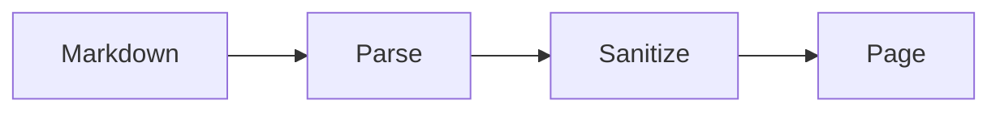
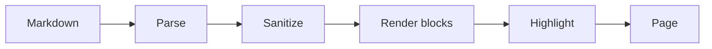

<!--meta
{ "title": "Add a Diagram", "description": "Turn a fenced block into a rendered, pannable diagram with the Mermaid plugin.", "assumes": ["Docs/how-to/writing"], "next": ["Docs/how-to/requirements"] }
-->

# Add a Diagram

WebDocs' core renders everything itself and ships no third-party rendering
library, so heavy diagram engines are not baked in. Instead a renderer plugin
system lets you opt in: enable the Mermaid plugin and a fenced block tagged
`mermaid` becomes a diagram; enable nothing, the default, and the same block is
just highlightable code. Write the diagram as a `mermaid`-tagged fence:

````text

````

With the plugin enabled it renders as a diagram inside a frame you can pan and
zoom — here is the pipeline a document travels through:




Every rendered diagram sits in a pan/zoom frame. Drag to pan; use the +, −, and
↺ (fit to view) buttons, which always work; and, once the frame has focus, zoom
with the mouse wheel — so scrolling past a diagram is never trapped. With the
frame focused, arrow keys pan, + and - zoom, and 0 fits; you can also drag the
frame's bottom edge to make it taller.

To enable the plugin, add its name to the `plugins` array in `config.json`:

```json
{ "plugins": ["mermaid"] }
```

On the next reload the loader imports the Mermaid facade from
`app/thirdpartyrenderer/`, which registers itself for the `mermaid` language. The
heavy Mermaid library is never committed, so a default checkout vendors no
third-party library — you supply the engine, and without it the block falls back
gracefully to its source plus a short notice.
[Diagrams & Renderer Plugins](Docs/features/diagrams) covers writing your own
renderer.

## Software designs: UML, sequence, activity and wireframe diagrams

For designs you edit by drawing rather than by writing text, the
`software-design` plugin brings in the Software Designer editor: class
diagrams, sequence diagrams, activity diagrams (with swimlanes and decisions),
and user-interface wireframes. A design lives in the page as a
`software-design` widget around a `softwaredesigner` block:

````text
<!-- meta start {"widget":"software-design","title":"Checkout"} -->
```softwaredesigner
{
  "format": "softwaredesigner/2",
  "elements": [
    { "id": "Customer", "type": "actor" },
    { "id": "Shop", "type": "lifeline", "link": "../services/shop.md" }
  ],
  "relations": [
    { "type": "message", "from": "Customer", "to": "Shop", "label": "placeOrder()" }
  ]
}
```
<!-- meta end {"widget":"software-design"} -->
````

Rendered, here is how a design goes from idea to page:

<!-- meta start {"widget":"software-design","title":"Adding a design to a page","height":520} -->
```softwaredesigner
{
  "format": "softwaredesigner/2",
  "elements": [
    {
      "id": "Author",
      "type": "swimlane",
      "children": [
        { "id": "start", "type": "initial" },
        { "id": "add", "type": "action", "text": "Add the widget", "done": true },
        { "id": "draw", "type": "action", "text": "Draw the design", "done": true, "link": "#software-designs-uml-sequence-activity-and-wireframe-diagrams" },
        { "id": "end", "type": "final" }
      ]
    },
    {
      "id": "WebDocs",
      "type": "swimlane",
      "children": [
        { "id": "save", "type": "action", "text": "Save into the page", "done": false },
        { "id": "read", "type": "action", "text": "Show it to readers", "done": false, "link": "writing.md" }
      ]
    }
  ],
  "relations": [
    { "type": "flow", "from": "start", "to": "add" },
    { "type": "flow", "from": "add", "to": "draw" },
    { "type": "flow", "from": "draw", "to": "save" },
    { "type": "flow", "from": "save", "to": "read" },
    { "type": "flow", "from": "read", "to": "end" }
  ]
}
```
<!-- meta end {"widget":"software-design"} -->

The block is JSON in the Software Designer format: what the diagram means
(its elements and how they relate) comes first, and where things are drawn is
kept apart in an optional `layout` section. People and AI tools can read and
write it; a diagram written without a layout is laid out when it is opened.

When reading, the diagram sits in the same pan/zoom frame as other diagrams.

- **Edit** opens the full editor over the page, for readers who may edit it.
  **Save** writes the diagram straight back into the page; **Close** returns
  to the page, asking first if there are unsaved changes.
- An element can **link** to another page (a path such as
  `../services/shop.md`, resolved like a Markdown link), to a section
  (`#checkout`), or to a web address. Linked elements show a link mark;
  clicking one follows it.
- An element can carry a **checkbox**, saved as `"done": true` or `false`,
  for marking stages of a plan complete. Readers who may edit the page can
  tick it right there; each tick is saved into the page.
- **Text** shows the diagram in words. The same description is always in the
  page for screen readers and for AI tools that read pages, and every shape in
  the drawing is tagged with its element id and type.

In the page editor, add one with **+ Add widget → Software design**; its
settings hold a title, a height and an **Open diagram editor** button.

To enable it, build the library in the Software Designer repository
(`npm run build:embed`), copy `dist-embed/softwaredesigner.js` to
`app/thirdpartyrenderer/softwaredesigner.js`, and add the plugin to
`config.json`:

```json
{ "plugins": ["software-design"] }
```

Without the library, a design falls back to showing its JSON. A bare
`softwaredesigner` block outside the widget is shown read-only.
